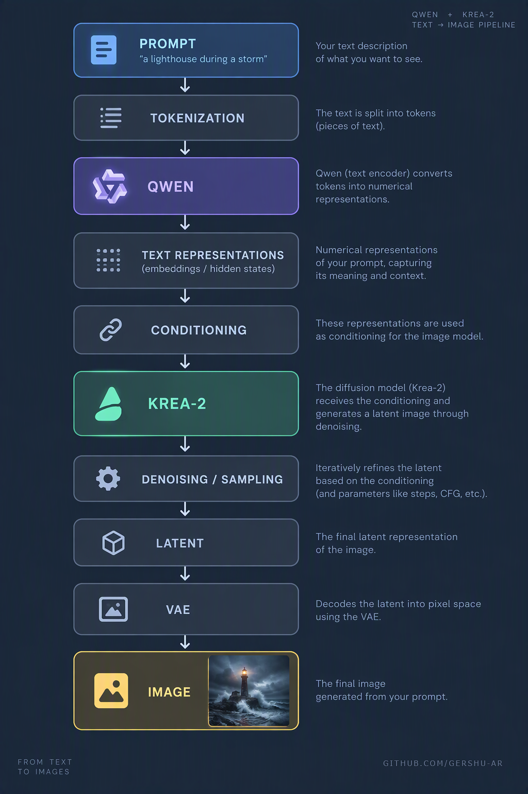
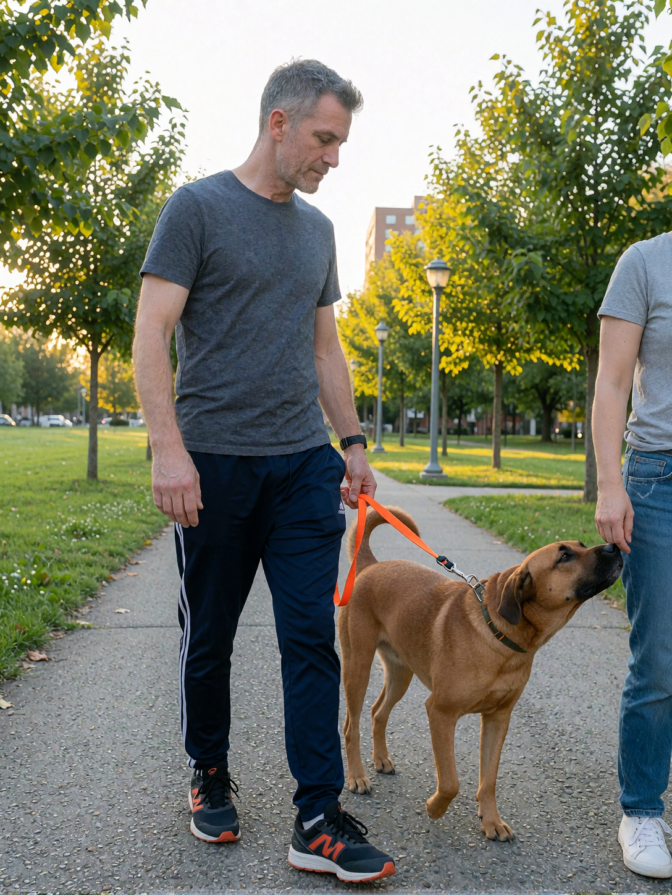
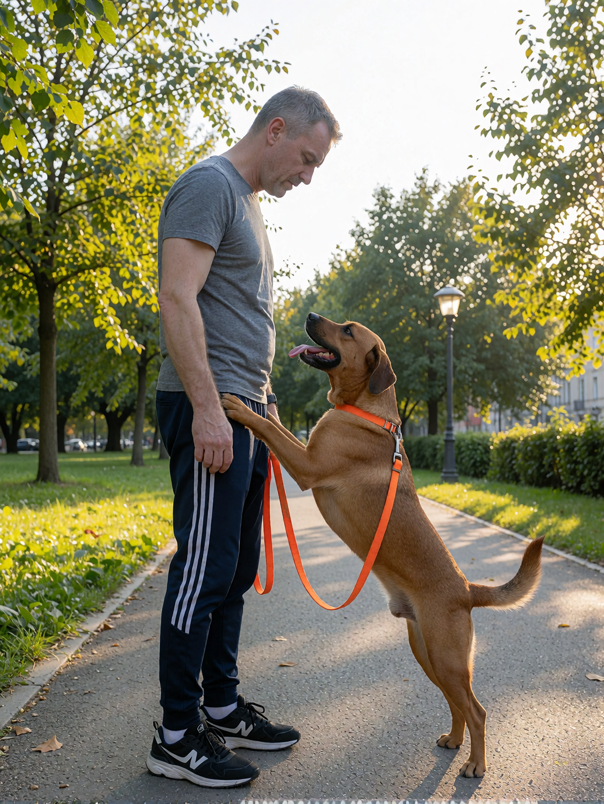
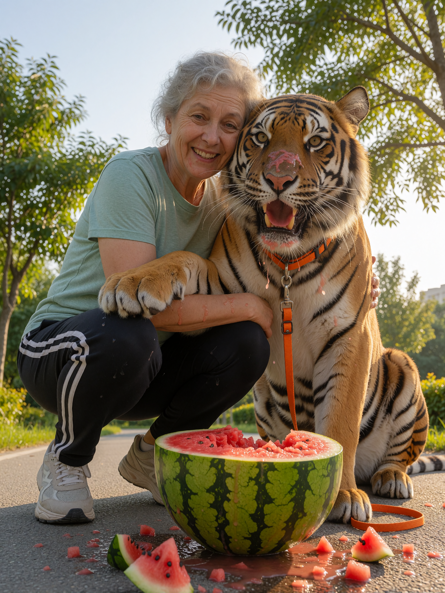
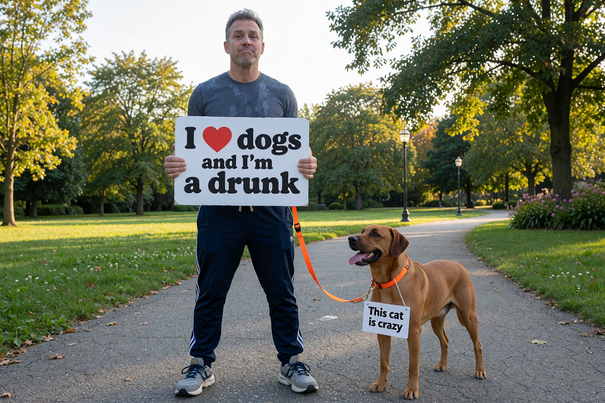
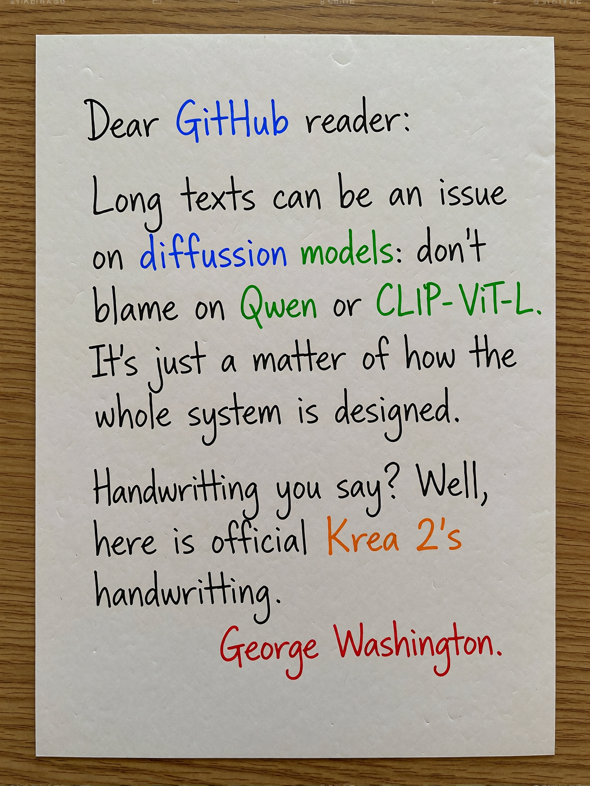
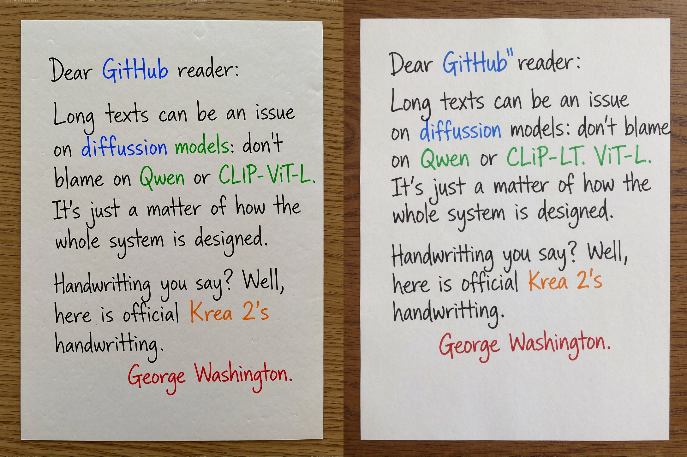
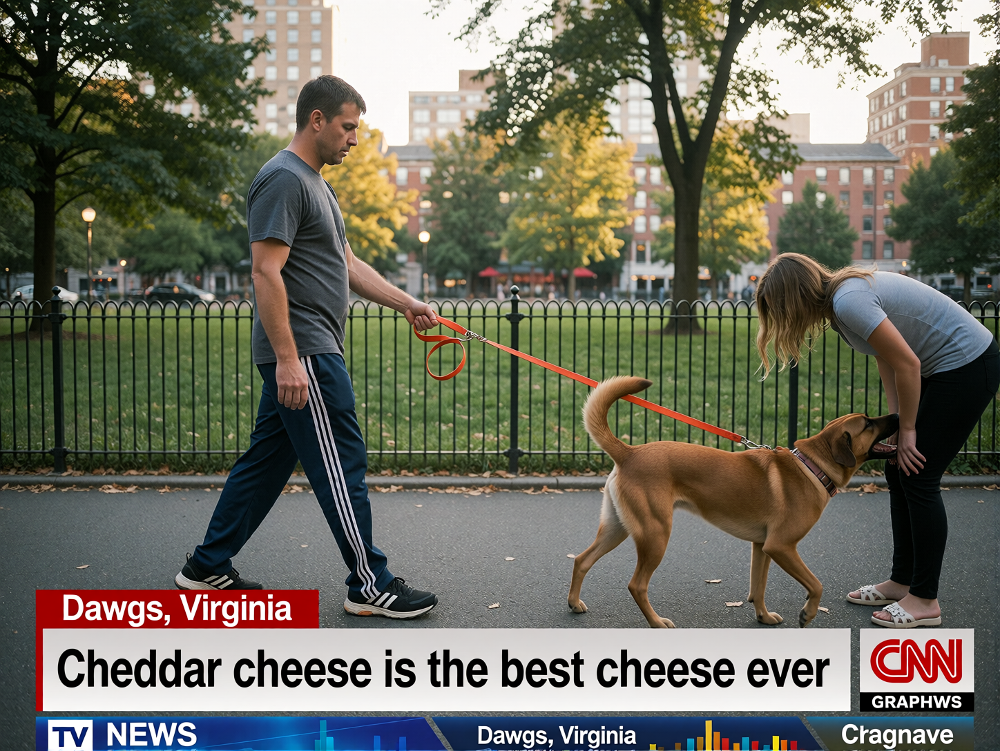
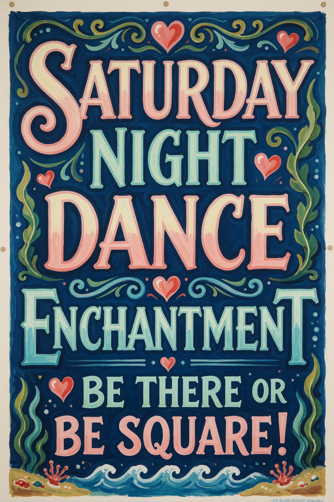
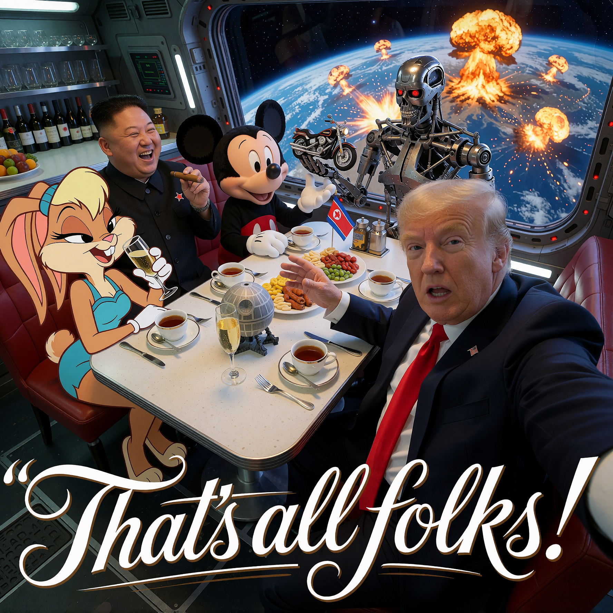

# 🎨 Qwen / Krea 2 on ComfyUI
### *The Totally Unrequested Prompting Guide*
---
**Prompting and rendering with NSFW & SFW Krea 2 model checkpoints** 
`text 2 image` *for the purist prompter*  

⚙️ `RATED PG16` — *Contains **mild language** - This article DOES NOT contain adult images nor sexual references of any kind*

##### This guide is being 97% human-written by a non-English language native (sorry for destroying your language), with 3% AI assistance (Gemini + Copilot), mostly on markdown adherence, one graphic and English spell check.  It is updated regularely.

> Notice: This is NOT the final version. This guide is being fact-checked, expanded and corrected one chapter at the time. You fill find errors / imprecisions until the process is completed.  I appreciate the patience, this is the work of an enthusiast, not an expert.

*Rendered using Krea 2 NSFW [FinePorn](#foot-notes--qa--recommended-models) checkpoint on [ComfyUI](https://github.com/comfy-org/ComfyUI "ComfyUI") portable v0.36.0, revealing model's capacity to generate comic-like illustrations* *Original PNG with workflow embedded*

------------
## THE BIG OLD INDEX
1. [The 101](#the-101) 
2. [Bootcamp](#bootcamp) 
2.1. [QWEN/Krea 2 vs SDXL](#qwenkrea-2-vs-sdxl) 
2.2. [Prompting on Qwen](#prompting-on-qwen) 
2.2.1. [Structure, structure, structure](#structure-structure-structure) 
2.2.2. [One -or a few- words to rule them all](#one-or-a-few-words-to-rule-them-all) 
2.3. [Remember](#remember) 
2.3.1. [Faceoff](#faceoff) 
2.4. [Every great lie has a lot of detail](#every-great-lie-has-a-lot-of-detail) 
2.5. [Mark Twain yourself thru Qwen](#mark-twain-yourself-thru-qwen) 
3. [NSWF vs SFW](#nswf-vs-sfw) 
4. [Melting faces, water droplets and artifacts](#melting-faces-water-droplets-and-artifacts) 
5. [Don'T be so Negative: try to see the Light](#dont-be-so-negative-try-to-see-the-light) 
6. [Cut!](#cut) 
6.1. [Parenthesis: No shoes, no admittance](#parenthesis-no-shoes-no-admittance) 
7. [Size **does** matter — and so does aspect ratio](#size-does-matter--and-so-does-aspect-ratio) 
8. [A not so short word about the Classifier-Free Guidance (CFG)](#a-not-so-short-word-about-classifier-free-guidance-cfg) 
9. [*Nutshelling* it](#nutshelling-it) 
10. [Foot notes / Q&A / Recommended models](#foot-notes--qa--recommended-models)

------------
Disclaimer: There are probably a ton of errors in this article.  Suggestions are always welcome, drop me a line!
- **Want to improve this article?** Fork this repo, edit the file, and submit a **Pull Request**.
- **Want to leave a comment or feedback?** Start a conversation in [Discussions](https://github.com/gershu-ar/gershu-ar/discussions "Discussions").
------------

 

## The 101

A pure Krea 2 text-2-image pipeline flow visualized - Generated with Copilot - Click here to view the prompt used

----------------------------------------------------------- 

Microsoft [Copilot](https://copilot.com/), with image generation option activated, automatic thinking mode. 
Version unknown - Microsoft does not releases Copilot versioning. 
----------------------------------------------------------- 
Prompt: 
----------------------------------------------------------- 
"Based on the following text, I'd like for you to generate an instructive graphic for an article about prompting.  Don't go wild, don't use weird images or graphics.  Clean, classical, nicely adapted to GitHub's color palette.  Make it nice, not necessarily formal.

'PROMPT 
↓ 
TOKENIZATION 
↓ 
QWEN / TEXT ENCODER 
↓ 
TEXT REPRESENTATIONS 
(embeddings / hidden states) 
↓ 
CONDITIONING 
↓ 
KREA-2 
↓ 
DENOISING / SAMPLING 
↓ 
LATENT 
↓ 
VAE 
↓ 
IMAGE'"

Highling these three concepts of the list:
- PROMPT
- QWEN (do not highlight '/ TEXT ENCODER', only 'QWEN')
- KREA-2 

----------------------------------------------------------- 

The **prompting** is not the beginning nor the end, but a journey in between software and hardware with hardworking people behind it all coding what is the stagging point for your idea to become true.

Consider **your prompting as the first of an eight step program to bring to reality a representation of what is only in your head**.  Machines cannot read minds (yet) and human language is complex, imperfect and grossly inefficient.  In the understanding the same math that takes shape from your words is the one used to *fill in the gaps*, the poetry of numbers can only be out shadowed by the harmony of meaning in so many precise words. 

That is what this guide aims to.  Having said that, you're all set for Bootcamp!

👆 [Back to index](#the-big-old-index)
  
## Bootcamp

Welcome!

My tool of choice is the mighty **[ComfyUI portable](https://github.com/Comfy-Org/ComfyUI/)** (v0.44.0 as of NOV/2026).

For almost all the examples presented in this guide I worked with [several models](#foot-notes--qa--recommended-models "Used models") and used a few ([A](https://huggingface.co/Winnougan/Krea-2-Base-Turbo-NVFP4-FP8-INT8/blob/main/Text%20Encoder/qwen3vl_4b_uncensored_int8_convrot.safetensors) and [B](https://huggingface.co/DreamFast/Qwen3-VL-4b-Heretic-ComfyUI)) Qwen3-VL-4B `INT8` Convrot *Text Encoders* with the default Qwen *Image VAE*.

Knowledge gathered and examples rendered on a local setup:  Windows 11 25H2, iCore Ultra 7 265K, 64 GB RAM (DDR5) with an NVIDIA RTX 3090 (24 GB VRAM, Studio Drivers) as the powerhouse being able to handle `bf16` quantization but choosing to use `int8` models simply because they **fly** on Ampere architecture leaving a massive overhead of free VRAM for the Text Encoder and whatever else I require.  Output quality is perfect for my needs and artifacts are negligible to none.

> `bf16`, `int8`, `nf4`, ... at the [very end](#foot-notes--qa--recommended-models "very end") of this guide the appropriate quantization model for your GPU/s is suggested.

Also, for your convenience, [you can get here](https://github.com/gershu-ar/gershu-ar/blob/main/articles/workflows/Purist%20Krea%202.json "you can get here") a **simple, purist Qwen / Krea 2 ComfyUI workflow** in case you feel like testing prompts as you read along. Just hit the three dots, select _Download_, and drag the `.json` file straight into your ComfyUI canvas.

The workflow is based on the [official Comfy](https://comfy.org/workflows/11657ed32877-11657ed32877/ "official Comfy") `text 2 image` (t2i) workflow, using *Nodes 2.0* format. We're going [Amish](https://amishamerica.com/do-amish-use-technology/) on this one:

It has been *de-automated* (stripped of LLM prompt enhancements) and *un-LoRAed*: there is just one **positive** prompt box, seed control, model selection, a latent (image) size selector (in *megapixels*), and KSampler settings. Back to basics! *Utility nodes* are tucked inside the subgraph and out of the way.

**Wait** ✋. No **negative prompt**? Nope. In Krea 2, negative prompting is nullified by design.

Krea 2 was conceived as an aesthetic model: it takes the minimal amount of artistic liberties based on a minimalistic nature to fill in the blanks by receiving a fully contextualized scene from Qwen, but neither will deviate from your instructions nor randomize results. If there's something you don't want, simply don't prompt for it or prompt for the direct opposite.

Turbo model variants (the ones used and referenced throughout this guide) are *guidance-distilled*; the conditioning alignment behavior comes already *pre-cooked*. That is also the [reason](a-not-so-short-word-about-classifier-free-guidance-cfg "reason") why the `CFG` in Krea 2 shouldn't deviate from `1.0`.

Back to the workflow, the provided arrangement is set for live image previews (unless you disabled them on your ComfyUI) and final saved/generated image view to work on a widescreen format.

You can, of course, arrange the workflow as you please. **That's the beauty of ComfyUI** ❤️

*A Qwen / Krea 2 [purist ComfyUI workflow](https://github.com/gershu-ar/gershu-ar/blob/main/articles/workflows/Purist%20Krea%202.json) with generation preview, the auxiliary nodes are comfortable set in a subgraph.*
  

***NSFW .... wait...? Am I here to learn how to create porn?***

| No  | Yes |
| ------------ | ------------ |
| Don't be confused: NSFW models render perfectly dressed scenarios and I consider them excellent at rendering dressed people precisely because clothing is not enforced by the model and I get to choose what and how clothing is being worn.  On SFW models there's the possibility of ruining certain clothing or even a pose on the account of avoiding showing nudity or the possibility of showing nudity.  | If you want to, you can.  |

**This guide is about Qwen / Krea 2 prompting engineering**, *not for determining the use you give to these tools*.  That, amigo, is entirely up to **you**.

> Only one strong request: **Kindly keep children out and away its use**.  Do not use these tools to generate content of people under 18 years old in sexual or suggestive situations.  Neither allow people under 18 years old to access these tools.

Enough introduction.  Let's start.

#### **QWEN/KREA 2 vs SDXL**
Qwen and Krea 2 do not fill in the empty spaces.  In Qwen / Krea 2 no prompt, no tokenization, no embed.   If you have not described it, it will not be there.  *Mostly*.  Gaps will be completed to round up a context and provide a presentable product, but remove from your head the idea of the model doing what you don't want to.  Qwen and Krea 2 require rich prompts to properly generate specific rich renders and **oh boy if they deliver**!

**You can throw simple prompts and Qwen/Krea 2 will provide**, just don't confuse it with **specific shots**, where light, angle, character description and such play a role, specially if you're under the idea of continuity in between frames (story telling, video generation).

As for SDXL's CLIP **ViT-L** it was created to be **light**, **tolerant**, and to **guess**, not to follow strict orders.  SDXL does an amazing job at being casual, but you will pay the price in Qwen/Krea 2 if your mindset is along that pipeline.

Extensive detailed prompts in SDXL require a lot of external nodes to position region, render faces properly, have body proportions as desired on that dreamed setting that randomly appeared without a true control.

Also, SDXL experiences something denominated *CLIP chunking* (aka *context window,* aka *token chunking*, aka *prompt truncation*, aka *token boundary effects*), with about 75 useful tokens per chunk:

    Prompt Chunk 1
    [0-75]
    
    Prompt Chunk 2
    [76-150]
    
    Prompt Chunk 3
    [151-225]

This means the prompt gets cut into pieces and then fed to the model.  If the chunks do not make sense separately the model is unforgiving about the results -> the longer the prompt, the less sense the output made.

Yes, mods/nodes exist to tackle the issue to different degrees, but they require installation, certain level of technical knowledge and of course dedicating time to it: just for a prompt to make sense.   The good news: **this does not happen on Qwen / Krea 2**.  As you will read time and time again in this guide, Qwen and Krea 2 overcome plenty of technical limitations SDXL experiences and all it cares is about clean instructions.  If you make sense, Qwen and Krea 2 will make sense.

To sum up: If you're coming from SDXL you will notice that **Qwen/Krea 2 is a whole new ball game in prompting**. Takes a few days to catch up on the style but the results are exponentially better, **Krea 2 has a lot of potential**.  You will not go back to SDXL.  Guaranteed.

**Keep in mind these tips are not noticeable on small prompts but the richer the prompt gets, the more characters are part of it, that's when word precision becomes a must.**

👆 [Back to index](#the-big-old-index)
  
#### **PROMPTING ON QWEN**
#### Structure, structure, structure

Qwen interprets and generates embeddings in natural language.  The limitations of SDXL were obvious  is not present here: every word counts, every sentence has a meaning and *poetry* is not corny but what makes a fantastic output.

A suggested prompting technique involves **separating the prompt in categories**, specially for complex scenes with multiple characters.

Here's a crude explanation of a sample prompt:

    Subject details: Uniquely name and describe each character on the scene.
    
    Attire context: Using the names you defined above, describe how are they dressing.
    
    Action: Describe the actions your characters are doing, calling them by their given name.
    
    Camera: As name suggests, this is where your camera stands.  Hard to master.
    
    Environment: Where are the characters in? Describe it as detailed as possible.  Time of day, objects around, furniture, background, setting.
    
    Lighting: Same as camera, the lighting prompting is hard to master (models force light by default and prompt needs to tackle it wisely).
    
    Textures: Skins, fabrics, liquids, etc.

Structure your prompts into modular blocks so they're easy to tweak, making it seamless to add or strip out situational elements while respecting the hierarchy.

**Qwen generates embeddings from your text to build a context that conditions Krea 2 in a precise sequence**. It's not strictly about what gets drawn first or last, but about how each descriptive layer connects to the next in the final composition.

Characters or focal subjects are typically prompted first because the whole scene revolves around them; you're establishing them as the anchor while laying down the baseline conditioning for the *mathematical mess*  that ultimately resolves into an incredible image.

**EXAMPLE** 
Let's prompt for a simple scene:

    Subject details: A man, 45-years-old middle-aged, unfit, ugly. A dog, brown.
    
    Attire context:  Man is wearing sports pants, a t-shirt and sneakers. Dog is wearing an orange leash.
    
    Action: Man is walking Dog on the pathway. Dog is sniffing on another person.
    
    Camera: Wide full body shot taken from across the room at eye level, 35mm lens, Man is framed completely within the surrounding environment with ample distance between camera and subject.
    
    Environment: At a city park on a pathway.
    
    Lighting: Natural afternoon light, golden hour.
    
    Textures: Realistic skin.

Ouput:

*Rendered using NSFW [FinePorn](#foot-notes--qa--recommended-models) checkpoint - Original PNG with workflow embedded*

**EXAMPLE** 
Slightly modifying the same scene by adding "Dog is setting paws on Man" (only changing the dog action), rest remains the same:

    Action: Man is walking Dog on the pathway. Dog is setting paws on Man.
    
Output:

*Rendered using NSFW [FinePorn](#foot-notes--qa--recommended-models) model - Original PNG with workflow embedded*

After contextualizing the scene, it filled the gaps and presented the intention with accuracy, even repeating the (kind of the same) same background and general scenery.  **Priorizing the big picture over small details**, and this is where we/you need to come in.

As you see on the examples both renders look **almost the same**. Liberties are visible.  The reason: I did not give a description for the sneakers, or the grey tone on the shirt, or the pants.  Hardly any continuity based on a poor prompt description.

Also pay attention how it gets confued on *ugly* and *fit*. That dude does not stand out: his human face is what is expected to be. See, *Ugly* by itself has no meaning, it needs to be described or at least contextualized: *long nose, deformed cheeks*, whatever. Same for the *unfit*. What is *unfit*? Unless you describe it, *unfit* is a shallow concept free of meaning. *Unfit* can refer to several things not just to a body type description.

**LET'S GO MEDIEVAL EXAMPLE** 

In Qwen / Krea 2 you can -and should-  atomize the prompt to the level of detail you require.  *Going medieval* involves sacrifying full text coherence for pieces of information that, if ordered and tagged properly, does the job beautifully.  

> Don't be confused about this method: It *feels* like SDXL but **it is not**.  You can extended yourself as much as you want on each block to achieve the level of detail you require.  Be poetic, the *block way*.

Here's a simple example of 2 (two) characters interacting in an unlikely real-life scene:

    [WOMAN]
    65-years-old elderly woman.
    [/WOMAN]
    
    [TIGER]
    Brown, unleashed.
    [/TIGER]
    
    [WOMAN ATTIRE]
    wearing sports pants, a t-shirt and sneakers.
    [/WOMAN ATTIRE]
    
    [TIGER ATTIRE]
    Unleashed orange leash.
    [/TIGER ATTIRE]
    
    [WOMAN ACTION]
    Standing hugging TIGER.
    [/WOMAN ACTION]
    
    [TIGER ACTION]
    Sitting, eating a watermelon on the floor, watermelon is flying around, watermelon pieces and juice on face, happy, leaning a paw on WOMAN to show appreciation.  
    [/TIGER ACTION]
    
    [CAMERA]
    Extreme low-angle shot positioned inches above floor level looking upward, wide-angle 28mm camera focal length, environmental full-body framing showing the complete figure against the room's height.
    [/CAMERA]
    
    [ENVIROMENT]
    At a city park on a pathway.
    [/ENVIROMENT]
    
    [LIGHTING]
    Natural afternoon light, golden hour.
    [/LIGHTING]
    
    [TEXTURES]
    Realistic skin, realistic fur, realistic hairs.
    [/TEXTURES]

***"Oh, little Whiskers loves his watermelon"*** 
*Rendered using NSFW [FinePorn v5](#foot-notes--qa--recommended-models) checkpoint - Original PNG with workflow embedded*

The pompt defined each character's form, clothing and action **separately** and **individually**, yet, **connected the action** on command:  She is hugging the tiger while the tiger is posing a paw on her as a sign of appreciation.

This prompting method makes it also easier to define characters, scene, clothing, camera, etc. and adapt the situation fast without needing to write (or re-write) endless *prompting poetry* all getting lost because a word was out of place.   Qwen / Krea 2 love detail but they also understand the idea when you slice it.  Just like **tasty watermelon** 🍉

Oh, Qwen, you cheeky, adorable bastard.

***WAIT, ALL YOUR PROMPTS USE DIFFERENT METHODS***

Yes.  There's no *universal way* on prompting on Qwen / Krea 2.
What it matters on the end is for the prompt to **make sense**.

    Subject: 45-years-old man.
Is the same as:

    [Subject]
    45-years-old man.
Or as:

    [Subject] 45-years-old man.

In fact:

    The spaces...
    
    ... in between.
Get ignored.

Commas, dots, semicolons, they all mean the same *to a point*.  The *what to do* is separated by coherence and contextualization not so much on how you write it.  Of course, proper writing using comas to enumerate/describe and dots to end a sentence do give a **strict meaning**, telling Qwen / Krea 2 **exactly** what you want in a very clear sense. 

Also, be sure to close the tag to be **extra clear** where your instruction starts and ends:

    [TEXTURES]
    Realistic skin.
    [/TEXTURES]

👆 [Back to index](#the-big-old-index)
  
#### ONE (OR A FEW) WORDS TO RULE THEM ALL

While working with *NSFW* models, prompting for a `Woman standing wearing a bath robe` will mostly render a woman standing wearing an **open** bath robe showing the body underneath as nude. **Why is she nude?** Because the **default statistical prior** of a robe is not to be closed/belted. This does not happen with the official Krea 2 model or models deemed *SFW* (clothed). *SFW* models enforce clothing by default based on the context.

Weighing between using *SFW* (forced clothing on models) and *NSFW* (fully unconstrained models) goes well beyond the clothing issue. As some examples show in this guide, some distilled/creator *NSFW* models excel over base Krea 2 models in many regards. Not conditioning the characters from the base regarding clothing makes *NSFW* checkpoints truly free from any *creative pollution*.

Moving on: `Long pants are seen on the floor` will render a pair of perfectly positioned pants, neatly laid out. **Why?** Because that's the **default statistical prior of the pants**: fully extended clothing, as if presented *for sale* or neatly folded. Add `messy`, `wrinkled`, or any other adjective that unquestionably conditions Krea 2 to produce a realistic pair of pants *that somebody threw on the floor*.

To get results on the spot, make sure to anchor the item to the character in the action to create a context that ends up making sense of how those pants should be presented.

For example:

    [CHARACTER_ACTION]
    ...
    Just undressed and threw pants on the floor, pants are seen on the floor.
    [/CHARACTER_ACTION]

Will render the pants right underneath the character.

Even more:

    [CHARACTER_ACTION]
    ...
    Just undressed and threw pants on the floor, pants are seen on the floor behind the character.
    [/CHARACTER_ACTION]

Yes. It will render the pants visibly behind the character; all I did was change the spot where the pants are. A few simple words locate the item where you need without the need to alter its description or purpose, all within the context you're setting.

Conditioning (prompt) links the concepts of `undressing` and `throwing` in the same action for the math to produce a pair of pants that look like somebody casually threw them there. If you want to be specific about *how* the pants lie on the ground, you also can; in fact, Qwen and Krea 2 want you to.

**Be detailed**. Qwen is expecting `closed` or `belted` for the bath robe and a more *messy* prompting scenario for the pants to achieve a realistic output. For Qwen that distinction is everything, and so it is for you: the pants, robe, or whatever you're prompting will maintain coherence between renders.

`Wearing summer clothes` is a general term and might confuse an *NSFW* model, ignoring the condition due to lack of context. **Why?** Because `summer clothes` is not exactly *an item*, it is a **group of items**, a generic term Qwen might not properly contextualize or Krea 2 take into consideration if the rest of the prompt does not give context to the clothing.

The same happens with `bikini` and two (or more) pieces of clothing as an outfit. `bikini` alone might be interpreted as the bikini bottom only, ignoring (not rendering) the bikini top. To be extra clear, make sure to prompt for `bikini top and bikini bottom`.

Also be descriptive about the color, fabric, and style of the clothing: Krea 2 will try to maintain the same style of clothing for coherence between renders, but chances are the clothing color/pattern will be wildly random unless specified.

How the characters are wearing the clothing is also taken very much into consideration and plays a very important role. `blue, plain t-shirt lifted` or `black suit pants pulled down` will achieve exactly that: a piece of clothing in a specific state.

👆 [Back to index](#the-big-old-index)
  

#### REMEMBER

You're not in Kansas anymore, Dorothy: **This is NOT SDXL.**

Using `(pants:1.5)` won't get you anywhere, there's no embed weighing on Qwen. Every word is as important as the rest, the weighing is done by Krea 2 once it receives the embeddings.  The more an embedding is repeated and playing a role on the context, the more it will comply to what is ask from it... as long as you don't over confuse it.

Thus, **a single word has Qwen-sequences and it can ruin everything.**

Same goes for LoRAs or whatever embeddings you used or want to use:

`<LORA:XXX bla bla>`

Don't.  There is not even..

`// Hey, this is a comment`

... on Qwen.

SDXL used to ignore `// COMMENT` but Qwen will give it some interpretation based on context and create an embedding **confusing the model**.  
  
👆 [Back to index](#the-big-old-index)
  
#### FACEOFF

Qwen / Krea 2 bond behind the principle of **mode bias / aesthetic convergence**.  A sort of *conditioning continuation in between seeds* bluntly put if you will.

**Render after render you're getting the same face on a character**.  And you feel **frustrated**.  Well, again: **this is not SDXL**.  And the answer is quite simple: **you're not prompting for face features or the context that face is set in**.  If you skip / avoid / become too generalistic, for coherence purposes, you will always get (about) the same exact face.

**There is no random face setting or magical prompt to achieve it.**

[Krea 2](https://www.krea.ai/blog/krea-2-technical-report) uses `Supervised Finetuning` and `RL with aesthetic reward models in post-training alignment`.  If there is no face prompt the diffusion backbone falls back to the reward model's highest-scoring facial distribution.

**Model resolves ambiguity with a safe prototype**, a standardized face that repeats itself for the sake of a safe prediction *on what comes next*.  Feels *dull* at first if you're coming from SDXL, but **amazingly flexible** once you understand how to prompt properly.

Can you generate a new random face on each render? **Yes**, but you have to guide the model by prompt and / or using the `Krea 2 Style Reference` node, already packed with Comfy.

Also, **disable / avoid using LLM** or prompt enhancer/s, you could trigger the LLM to force generate the same face (to achieve the purpose of aesthetic convergence), overriding even the style you visually referenced the model with.

"*If it's not going to change, why mess with it*?" would be the philosophy (works great with an ex too).

The same technical principe also applies for clothing, scenery and everything else you're not specifically prompting in detail.  Naming an item/character renders it, how detailed it becomes depends on how well you can describe it.  Model will try to mantain visual composure and relatable aesthetic of all the elements (layers) that don't require to change since the previous prompt unless specifically told to do so.

👆 [Back to index](#the-big-old-index)
  
#### EVERY GREAT LIE HAS A LOT OF DETAIL

You prompt for "**Pants**".

**Qwen/Krea 2 have mercy**: No item color specified? Pants colors will randomly change... or not: if the prompt has been repeated long enough along the +1 seed trend, modifying the scene (and as long as you don't mess with the pants), will maintain the random color it adopted by its own the first time.

This is playing with an uncertainty and a false security: the pants color will change randomly on every X render only to return to the series predominant color. But avoid that, use: "color pants" (color=black, white, green, etc). That will guarantee the exact same pants on each frame.

Extend it even more for detail and coherence: "Black sports pants with laces with a white tip". You will be getting the right color, type (pants), subtype (sports) and details (laces with a white tip).

**Details allow the repeating results effortlessly and provide the base for any realistic render:** **detail**. Life has detail, clothing fabric is not perfect, light is always terrible and shit happens. Models are trained on the basis of perfection, so Qwen is waiting to encode the terrible reality of life and Krea 2 to show it: don't be afraid to add extra details about a character's background or their intention within the context of the scene.

If your character is about to jump off a plane, add to the context: "The character is jumping off a plane for the first time in his life and is visibly mildly scared". Besides jumping off a plane, a sense of wonder, fear, curiosity will be added to the character's posture and even face expression if you haven't done so by prompting.  Qwen/Krea 2 won't be filling a blank but adapting to the situation.

Keep in mind the software you're using and the cache's circuit/purges. Instant results might not be visible from one render to the other: it might take 5/6 renders to start seeing results and a settled prompt into the cache (at least on ComfyUI). The more renders you run, the more you will see how the produced render takes the exact shape as you prompted it.

👆 [Back to index](#the-big-old-index)
  
#### MARK TWAIN YOURSELF THRU QWEN

**TEXT** 
One thing Qwen and Krea 2 are **EXCELLENT** at is text. **Wildly good at**.  On short text, that is.  Long text? That's a whole different chapter.

Still, in between getting proper rendered text while working with SDXL and winning the lottery, winning the lottery is a sure thing.

Let's start with a simple setup by implementing two simple prompt modifications to the *Action*  block:

    Action: Man is holding a professionally designed sign that reads "I love dogs and I'm a drunk".  Dog is standing next to Man staring at Man.  Dog has a small sign hanging from the beck that reads: "This cat is crazy".

**Produces exactly that**. The more you describe the medium (paper, sign, wall advertising, graph, etc.) the more realistic it will be:

*Rendered using NSFW [FinePorn](#foot-notes--qa--recommended-models) checkpoint - Original PNG with workflow embedded*

The shown example is crude and hasty at best, but illustrates simply how **easily you can add text** to any level of customization and simplicity or complexity you require.

**HAND WRITTING**

As for **handwritten text** -if used extensively or wanting a specific style- Dante's hell is a kid's playground in comparison: short specific phrases work like instant noodles, on the other hand, long text requires patience and proper prompting.

As the guide insists upon itself time and time again: prompt and models are not all the same. 

All models in the guide were tested and the results are worth sharing: surprisingly enough, creator's **NSWF Krea 2 models demostrate to excel over the official Krea RAW and Turbo variants** in all the run tests.

Visual human-like handwriting results require heavy prompting: the *prior* to handwritten text are perfect handwritten characters, aligned, with clean strokes, the *perfect idea of handwriting*.  Every day human writing is anything but perfect: people usually don't write aligned, they do it with characters varying in size, with different pressured applied on the paper, etc.  The good news it you can get realistically looking handwriting text if you prompt it correctly, just a heads up that is not an easy task. 

> Adding true human-like handwriting text prompts is pending.

For a simple handwritten note, you can throw the idea in the prompt, paying special detail when need on complex or long words.  You will need several renders to get 100% perfect matching text.

A prompt for a full note, "handwritten" style:

    [PAPER SCENE MODULE]
    A single sheet of white paper lying on a wooden desk, photographed from above, realistic natural lighting, focus on the paper, clean composition, realistic paper texture, documentary-style photography.
    
    [HANDWRITING STYLE MODULE]
    Casual handwritten text written with a black ballpoint pen, authentic human handwriting, slightly uneven character shapes, subtle stroke variations, minor baseline drift, natural spacing inconsistencies, readable but imperfect, not calligraphic, not typographic, not computer-generated looking.
    
    [TEXT CONTENT MODULE]
    The paper starts as a note:
    "Dear GitHub reader:"
    Word "GitHub"  must be in blue and spelled exactly: G i t H u b
    
    The paper follows:
    "Long texts can be an issue on diffusion models: don't blame on Qwen or CLIP ViT-L. It's just a matter of how the whole system is designed."
    
    Word "diffusion" must be in blue and spelled exactly: d i f f u s s i o n
    Word "models" must be in green and spelled exactly: m o d e l s
    Word "ViT-L" must be spelled exactly: V i T - L
    
    On another line:
    "Handwriting you say? Well, here is official Krea 2's handwritting" with words "Krea 2's" in orange.
    
    Signing the document in red:
    "George Washington" with a double underslash.
    
    [READABILITY MODULE]
    Clearly visible text, legible handwriting, high text fidelity, easy to read, sharp focus on the writing.

 

*Produces a note dubiously signed by a Mr. Washington:*
  

*Rendered using NSFW [Gonzalomo v4.0](#foot-notes--qa--recommended-models) checkpoint - Original PNG with workflow embedded*

Notice in the prompting the amount of stress some words required to be renderer appropriately.  

Output size also matters: If your render requires extensive, precise text, keep the image output or on above `2 PM - 1256x1672 pixels` , that gives Ksampler more room to maneuver, more pixels and space to work with. 

Despite the render was generated with NSWF [Gonzalomo v4.0](#foot-notes--qa--recommended-models) model, due credit goes to official Krea 2 in the understanding the base text training looks like undeniably related:

*Left: Rendered using NSFW [Gonzalomo v4.0](#foot-notes--qa--recommended-models) checkpoint - Right: Hastily rendered using Official Krea 2 Turbo model*

The tests run with all the models mentioned in the guide were equally satisfactory showing similar outputs with the same rendering mistakes on the same words, evidencing a relation to the same base training model/s.

Even so, is worth to mention NSFW [Gonzalomo v4.0](#foot-notes--qa--recommended-models) model notably surpassed the official Krea 2 model on the same handwriting testing tasks, with NSFW [FinePorn v4.0](#foot-notes--qa--recommended-models) being particularly more detailed under certain scenarios.

This adds to the positive understanding that retrained, repurposed models **not necessarily** neglect the other *elements in the universe*.  **Refinements on the models from the base versions are notorious and evident**; even more, trained NSFW models demonstrate remarkable flexibility and enormous generation capacities, superseding the base model of Krea 2 in every conceived SFW/NSFW scenario.

**OVERLAY GRAPHICS**

If you want more complex text or even **overlay graphics**, you can absolutely can by even creating them on the fly: Qwen / Krea 2 excel at it too, not as mathematicaly precise as Ideogram 3.0/4.0 which has been designed to work with text and coordinates in mind, but it certainly creates a commendable job with ease.

> Remember: **there're no universal difussion models**.  Each model was trained for and is capable of something **different**.  Some excel at doing *this*, other's excel at doing *that*; read the model's card and the creators notes to understand what model you have and what it can and cannot do.  *Try them all!*, I say.  Then decide.

One great feature about Qwen / Krea 2 is you can dedicate an entire prompt to the overlays/graphics or simply take advantage of the modular system and create an overlay graphic line without compromising the rest of your work.

Appending a new module to the sample prompt:

`GRAPHICS: there's a professional TV news lower-third overlay that reads "Cheddar cheese is the best cheese ever", with a graph title that reads "Dawgs, Virginia". The news company is "CNN".  The overlay graphic has a news station format and is positioned at the very bottom of the frame as a full-width banner spanning across the screen.`

The ouput:

*Rendered using NSFW [Gonzalomo](#foot-notes--qa--recommended-models) checkpoint - Original PNG with workflow embedded*

As you can see, Qwen / Krea 2 perfectly understood what I wanted and created the requested overlay graphics by word, **even using CNN's real life logo**.

It *filled the gap* (overlay's extra graphics/text) with **gibberish** but that's **partially my fault**: I did not fully specify all details the model was expecting to render the idea properly: model was trained with specific overlay graphics and I did not met the requisites.  **Usually news overlays exhibit a lot of extra information and I was short on my prompting**.  That can be solved by enhancing the prompt and/or creating prompts for very specific overlay graphics with very detailed instructions.

**FULL SIZED GRAPHICS**

You can also generate full sized graphics easily:

*Rendered using NSFW [Sick Ollie](#foot-notes--qa--recommended-models) checkpoint. - Original PNG file with workflow embedded.*

If you're a movie fan or a +40 years old you'll recognize the poster style almost instantly.  Zero challenge in rendering it... except for the word *enchantment*, **all models struggled** with that word, and they all rendered it "Enachantenent".

Here's the full prompt for the "Under the Sea Enchantment" dance poster:

    SUBJECT:
    a hand-painted high school dance poster from the 1950s, displayed as the main subject of the image
    
    COMPOSITION:
    the poster fills almost the entire frame, photographed straight-on, perfectly centered, no people, no surrounding room visible
    
    CAMERA:
    front view, poster photography, medium format camera, sharp focus, highly legible typography
    
    LIGHTING:
    even indoor lighting, soft illumination, no glare, no reflections, vivid colors
    
    POSTER DESIGN:
    large vertical poster with a rich deep blue background, decorative hand-painted lettering, retro American school event aesthetic, playful typography, pastel pink lettering, mint green lettering, hand-drawn hearts, seaweed decorations, waves, underwater motifs, charming handmade appearance, authentic 1950s school art project
    
    MAIN TITLE:
    "SATURDAY NIGHT DANCE"
    
    EVENT NAME:
    Word "ENCHANTMENT" must be spelled exactly: E N C H A N T M E N T
    
    TAGLINE:
    "BE THERE OR BE SQUARE!"
    
    TEXT STYLE:
    all text is large, readable, centered, beautifully hand-painted, vintage sign-painter lettering, highly accurate typography
    
    COLOR PALETTE:
    deep ocean blue, turquoise, mint green, coral pink, cream highlights
    
    STYLE:
    1950s Americana, nostalgic, handmade poster art, school dance promotion, iconic retro design, graphic design masterpiece
    
    QUALITY:
    perfect typography, flawless text rendering, poster design focus, graphic design showcase

A word of caution: you can run into issues rendering long or complex words in Qwen / Krea 2.  Yet, always keep in mind there's a way to fix it: no LoRAs, no pills, no diets but the *prompting finesse* way.

In the shown example to make Qwen / Krea 2 render **enchantment** properly all I had to do is to be **more specific**.

The original prompt was:

    EVENT NAME:
    Word "ENCHANTMENT"

The fix was:

    EVENT NAME:
    Word "ENCHANTMENT" must be spelled exactly: E N C H A N T M E N T

And voilá.  A proper beautiful full sized graphic in seconds.  **The absolute terror of every graphic designer**.

> As a side note, if I were to add "The" before "word"  ("*The word*..."), Qwen / Krea 2 would understand that I want "The" to be *announcing*/*presenting* the word **ENCHANTMENT**: that will render "The" above "**ENCHANTMENT**".  Go ahead and try both options, with and without "The" before "word" and you will notice it.

👆 [Back to index](#the-big-old-index)
  
### NSWF VS SFW

You need to render a character wearing a shirt. But even as you prompt the word "shirt" like a lunatic, the character appears time and time again with the shirt up, exposing chest. Why? Models learn the human body as a base structure, and clothing is learned as an additional layer. **When context is ambiguous, the model may fall back to the underlying anatomical prior**. **The base model, the layer is essentially a nude body**.

This is not about Qwen so much as the NSFW model: a SFW model should avoid that from the base.

"But my NSFW renders dressed people to me--", yeah, I get it. **Characters are not drawn nude by default, yet they do when the scene context plays in.** Some prompts tend to sex and  to a point that getting people naked is the obvious so in fact dressing them is the contrary. Creating context to fight the context in a way.

If I'm placing a man and a woman on a bed, and the action involves *caressing*, *kissing*, with an i*ntimate environment *and* low-key dim warm lighting* with a *fireplace* on the back chances are Qwen/Krea 2 will interpret that as a *clothes off scenario*. There's a sexualized context going on and will try to get one or both characters as dispossessed of clothing as possible. If clothes are not specified or the clothing is easily/highly removable (boxers, bras, bikini bottom,...) Qwen/Krea 2 go for it: I know I would ;)

Since prompting is everything, go for something like ***fully** wearing a XXX*. Stressing the action will create a stronger embed.

- **fully** wearing the t-shirt and the pants
- **fully** wearing a buttoned work shirt
- **fully** wearing bra and bottom underwear
- etc.

**Detail** -if coherent- **is what Qwen and Krea 2 feed about**.

👆 [Back to index](#the-big-old-index)
  
### MELTING FACES, WATER DROPLETS AND ARTIFACTS
Are you getting renders with faces melting like wax? Or excesive, unsolicited water droplets like the characters are sweating as a fake witness would do?

**This isn’t caused by INT8, FP8, or the VAE.** The water droplets/melted skin artifacts come from the checkpoint’s own wet‑skin prior, which is common in **models trained on glamour or NSFW datasets**.

Qwen isn’t misinterpreting embeddings — it simply triggers that prior when the prompt includes ambiguous wording or lighting conditions the model statistically associates with moisture.

**Check your prompt for terms that activate specular highlights, or reinforce the opposite:** *matte skin*, *dry skin*, *no water droplets*, *studio lighting*. "Wet <female sexual organ>", "semen" or even "saliva" can surely trigger it, even if they're perfectly prompted and situated into the scene context.

*Let the prompt undo what the prompt has done* I always say 😁

A very personal note on the matter: 
I have experienced this while working on prompts near/on water, even if there's a "pool in the background".  For a reason, characters appear with a wet skin (not so much melting faces).  I have produced renders with visible clear wet skin that seem to get triggered by prompting the word "kissing", in the contextual understanding there's saliva involved in a kiss.  Not all models react the same, but I have seen this as a generality in all tested Krea 2 models.  Perhaps is the way the models are trained (they mostly all use the same base training models after all), so there's a chance this is an embedding being taken out of proportion or misunderstood that is just getting copied from model to model.  Maybe is Qwen creating the wrong embeddings under certain scenarios?

👆 [Back to index](#the-big-old-index)
  
### DON'T BE SO NEGATIVE: TRY TO SEE THE LIGHT

The objective of this guide was self-learning by reading straight from the sources. *RTFM* -as it is colloquially known- and oh boy, **Krea 2 truly deserves it**.  All my own *SDXL vices* weighed heavily on understanding that this was something entirely new, not just *more of the same*.

As briefly referenced at the beginning, **there is no negative prompting in Krea 2**. The text encoder doesn't distinguish *the good* from *the bad* and *the ugly*, it simply visualizes whatever concept you put in front of it.

You might as well define the Qwen / Krea 2 pairing as a *happy bunch* only looking forward to the *positive* things in life.

Phrases like:

    no blur, no extra limbs, ugly

...mean nothing to either Qwen or Krea 2.

**Negative prompting works by describing the desired opposite directly inside the positive prompt**:

    sharp focus, clean studio photography, natural anatomical proportions

Qwen will contextualize the `sharp focus` conditioning because **it makes semantic sense**: *You want a crisp, sharp image, hence: no blur*.

The same prompt engineering principle applies to lighting, wardrobe, hair color, and everything else. *Randomness* is not the word of the day; *precision* is. Random results need to be deliberately prompted, while anything you don't want to see simply shouldn't be mentioned.

Yes, the link in between prompting and the final result is **that** strict.  You get to control mostly every single element on the render with just a few, precise words in clearly structured and defined short/long text blocks on a single prompt.

You can still appeal to **some degree of scripted or deliberate randomness**, but the outcome will depend on how Qwen interprets your intent and how faithfully Krea 2 renders it:

    [Subject] is sitting on a blue, red, or green sofa.

It *could*, *would*, or *should* pick a single color for the couch, but don't be surprised if you end up with a three-colored sofa, or cushions mismatched across all three hues.

As for the **lighting** issue itself, it's quite the **nightmare** if you want to work with nuances on **dark/low light/moody** scenarios. **Daylight scenarios are fairly easy, low-ISO's are a true challenge.**

> 🚧 Guide will be expanded to add more advanced lighting prompting.

Simple prompting for high-ISO (daylight) scenarios can be:

| Style / Concept | Lighting Configuration (Prompt) |
| :--- | :--- |
| **Bright Window Diffusion** | `LIGHTING: Bright daytime interior flooded with soft natural daylight streaming through large window sheer curtains. Clean high-key ambient illumination with gentle highlight falloff, open shadow details, balanced high-ISO film grain, and crisp true-to-life skin tones without harsh sunlight.` |
| **Direct Sunlight & Hard Contrast** | `LIGHTING: Intense direct midday sunlight pouring into the room, creating strong geometric light patches and high-contrast dark shadows. Vibrant exposure with natural lens flare, crisp highlights, visible ambient ISO grain, and dramatic warm light patterns across the subject.` |
| **Overcast Soft Box Effect** | `LIGHTING: Bright daylight indoor scene lit by soft diffuse skylight from an overcast afternoon. Evenly distributed natural ambient light eliminating harsh shadows, smooth skin texture highlights, neutral color temperature, and clean photo-journalistic grain.` |
| **Golden Hour Golden Glow** | `LIGHTING: Late afternoon golden hour natural light coming through side windows at a low angle. Warm amber directional illumination filling the room with a rich golden glow, soft elongated shadows, high-ISO ambient texture, and vivid natural contrast.` |

If it's low-ISO shots we're talking about, then game changes.

Positive `Lighting` embeds alone cannot always succeed.  Not all models are equally compliant with the prompt and those who do require very specific words.

To understand how sensitive `Lighting` prompting gets, imagine that if you turn the camera (modifying `Camera` prompt module) from the front to the side of a character, you also need to adjust the `Lighting` prompt if you're to maintain the same light effect.  It can get tricky for specific lighting scenarios, but going back to the basics always gets the job done.

Some examples for **low-ISO & ambient night lighting** prompting:

| Style / Concept | Lighting Configuration (Prompt) |
| :--- | :--- |
| **Corner Warmth & Soft Shadows**| `LIGHTING: Nighttime interior with no camera flash. The room is illuminated entirely by a single floor lamp with a fabric shade in the corner, casting a soft orange warm glow across the walls. Deep natural shadows in the unlit areas, with soft warm light gently falling on one side of her face and sweater. Authentic high-ISO low-light photography atmosphere with clean natural shadow falloff.` |
| **Cozy Tungsten Ambience**| `LIGHTING: Dim night lighting with zero artificial flash. Ambient evening warm light originating from two muted table lamps and a floor lamp scattered in the background. The center of the room relies purely on this indirect tungsten illumination, creating soft highlights, rich dark corners, visible fine noise in the shadows, and a cozy warm-toned nighttime aesthetic.` |
| **Off-Frame Amber Directional**| `LIGHTING: Available-light night indoor photo, shot strictly without flash. Soft directional amber lighting from a warm floor lamp situated just outside the camera frame. Strong contrast between gentle warm highlights on the subject and deep atmospheric shadows filling the rest of the dark living room.` |
| **Moody Backlit Silhouette** | `LIGHTING: A dark room lit solely from behind by a warm ceiling lamp, creating a strong backlight rim effect. The faces are in deep shadow and partially underexposed, with no fill light or camera flash. The background behind has a soft warm glow while her silhouette and profile remain mostly dark and moody, ambient high-ISO grain.` |

Different models will produce different outputs: there's no single, universal way to interpret lighting and Krea 2 models do not hide it.

**Be aware all Krea 2 models handle lighting differently**.  Sometimes a specific lighting shot can only be achieved with a specific model.

All models **look the same, but they are not.**

👆 [Back to index](#the-big-old-index)
  
### CUT!
Prompting for camera angles proves challening on any difussion model, also for the reason on how they have been trained, but **with precise prompting you can achieve practically any shot you can think of**.

> This section will be expanded eventually; for the time being some examples are provided for simple camera prompting.

Start with simple camera prompting, as natural as you can:

`CAMERA: Wide shot, full-body`, 
`CAMERA: Low angle shot`, 
`CAMERA: Cell phone amateur tilted shot, blurred background` 
etc.

You also can (and should) mention the subject's into the camera's prompt:

A `tight focus on facial features` prompt is not the same as `tight focus on the hand of the female` if your're rendering a macro close-up.  If there're two people on the scene, the first prompt will focus on both (since facial features **apply to both**), not producing a true macro close-up, while the second will focus on the hand of the female: **specific character, specific body part**.

Prompting for the render to stylize with specific lenses or filters does work and make wonders.  Examples will be added latter on, this guide is on-going.

For the time being, explore with these six camera examples:

**Full Body & Environmental**

| Angle / Plane | Prompt |
| :--- | :--- |
| **High Angle Wide Shot** | `CAMERA: Shot from a high angle looking down at a steep downward tilt, wide environmental 24mm lens perspective, full-length shot capturing the subject's entire body from head to toe, wide framing with generous headroom and visible floor space.` |
| **Low Angle Wide Shot** | `CAMERA: Extreme low-angle shot positioned inches above floor level looking upward, wide-angle 28mm camera focal length, environmental full-body framing showing the complete figure against the room's height.` |
| **Distant Eye-Level Shot** | `CAMERA: Wide full-body shot taken from across the room at eye level, 35mm lens, subject is framed completely within the surrounding environment with ample distance between camera and subject.` |

**Close-ups & Portraits**

| Angle / Plane | Prompt |
| :--- | :--- |
| **Candid Smartphone Close-Up** | `CAMERA: Tight close-up portrait taken with a mobile phone main camera, shot slightly above eye level, intimate close framing focusing tightly on the face and shoulders, shallow depth of field with natural background separation.` |
| **Over-the-Shoulder / Dutch Angle** | `CAMERA: Medium close-up shot over the shoulder, camera positioned at a subtle Dutch angle (tilted frame), 50mm portrait lens perspective, tight framing from the chest up.` |
| **Extreme Detail Close-Up** | `CAMERA: Macro close-up shot, 85mm lens perspective, tight focus on facial features and eyes with the rest of the scene falling into a heavy blurred bokeh.` |

It's suggested to use IA (Gemini, Copilot, ChatGPT, etc) to assist in creating prompts to render **very specific camera angles** views.
  
👆 [Back to index](#the-big-old-index)
  

### PARENTHESIS: NO SHOES, NO ADMITTANCE

Yes, the fancy party you attended denied you access because you didn’t read the invitation properly: *casual sport* does not include *surfer* attire.

Both Krea 2 and SDXL (like any other diffusion model) will take you for a ride depending on what you ask for: **are you prompting for a character portrait render (waist-up)? Then do not prompt shoes or any specific waist-down item.**

Krea 2 will do the thinkable and the **unthinkable** to squeeze them into your render. The character will end up raising a foot (to show off the shoe) or adopting an awkward pose to bring those requested kicks into frame: *sitting down*, *squatting*, *kneeling*, etc.

Even if you emphasize the word `standing` in the pose description, **Krea 2 will make sure those shoes are there.** The subject's composition conditioning supersedes vague or contradictory posture conditioning, especially if the character description comes before the posture prompt. Conditioning follows a specific hierarchy, much like layers in a Photoshop file.

**The exact opposite happens too:** you prompt for a full-body shot (head to toe), but you keep getting a portrait every single time. You even reinforce the framing inside your `[CAMERA]` block to make it crystal clear:

    [CAMERA]
    ...
    Wide framing with generous headroom and visible floor space, subject is framed completely within the surrounding environment with ample distance between camera and subject.
    [/CAMERA]

Yet all you get is a waist-up render of a half-baked idea.

Chances are, in that scenario, **you completely forgot about shoes, socks, or any lower-body anchor that gives the model a reason to render below the belt.**

The fix inside your prompt is simple:

    [FOOTWEAR]
    Bare feet.
    [/FOOTWEAR]

Or simply append `bare feet` directly to your character description in the relevant block.  `Bare feet` is just an example, of course.

Doing this gives Krea 2 an explicit instruction to draw the legs and feet. **The model now has a creative, semantic reason to render the entire body that goes well beyond camera framing alone; it gives the rest of the body a purpose to exist in the scene.**

As the guide insists: A single word (or two, in this case) does have Qwen-sequences 👣

  
👆 [Back to index](#the-big-old-index)
  

### SIZE **DOES** MATTER — AND SO DOES ASPECT RATIO

> While this article is about prompt engineering, I'd like to take a short detour into two very important elements closely linked to prompting: the latent size and ratio.

Nothing in this guide will work properly without adequate framing and pixel arrangement: you specify the `what`, but the `how` is driven by two key settings: the **latent (image) size** and, most importantly, the **aspect ratio**.

**The latent (image) size**, measured and pre-set in megapixels in Krea 2 for convenience, **defines the level of resolution (so to speak)**. It marks the difference between blurry background faces and fully resolved ones, or rendering subtle details like natural teeth discoloration, freckles, sparks, and whatever else requires *detail*. This *detail* **doesn't mean adding extra elements to the scene**, but rendering what is already there with much finer clarity when zoomed in. The larger the latent size, the longer the render time, and the more refined the final output. Up to a point.

If you are familiar with printing, latent size works much like the concept of `DPI` / `PPI` (`dots per inch` / `pixels per inch`). Finer density means a crisper print. Yet, again, only to an extent.

**So, beware**: There is a **precise setting where perfection is achieved**, in rendering and in printing: *under-rendering* and *over-rendering* are real and very common. Higher does not necessarily mean better: it all depends on your eye and the final destination for the render. **Test low, master high**.

Oh, and the often-overlooked **aspect ratio**: in practice, it is even more critical than latent size because it defines the **boundaries** of your canvas.

If you prompt for five (5) people within a vertical 9:16 ▯ ratio, Krea 2 will struggle to squeeze them into the frame, often forcing weird postures, overlapping bodies, or cutting people out entirely.

A widescreen (16:9 ▭) format is far better suited to line them up with room to spare, though you might initially get a waist-up shot unless you explicitly prompt for a full-body camera angle.

It also works the other way around: if you prompt for just two (2) characters in an ultra-wide frame with a wide lens, high chances are Krea 2 will generate duplicate or extra characters just to fill the empty space. While solid positive and negative prompting can help prevent this, picking the right aspect ratio from the start gives the model the natural boundaries it needs.

| To sum up |
| :--- |
| Qwen and Krea 2 try hard to fit everything you ask for, but **they are not magicians**: **give your prompt room to breathe**. Before generating, imagine your shot as if you had to *frame it and cut it from a real-life scene*. Be economical with your canvas to save time and get cleaner results. |

If in doubt, a **1:1 square ratio** is a solid, neutral baseline to test; most workflows also include quick presets tailored to whatever platform or medium you are targeting.

  
👆 [Back to index](#the-big-old-index)
  

### A NOT SO SHORT WORD ABOUT CLASSIFIER-FREE GUIDANCE (CFG)

> Keeping on the detour, `CFG` is very much worth a word too.

Put simply, `CFG` ([**C**lassifier-**F**ree **G**uidance](https://arxiv.org/abs/2207.12598)) is a technique used to **steer sampling toward or away** from a **conditioning** signal (a text prompt in our case). It's about emphasis and direction, not about freedom or creativity.

`CFG` **does not** equal or behave like `Temperature` does in LLMs, although you wouldn't be wrong to see them as conceptually similar. Mathematically speaking, however, `CFG` and `Temperature` work differently.

> You can set `CFG` directly in ComfyUI, while some other UIs use preset or automatic `CFG` levels, taking away some control over an important part of the creation process.

Since the `CFG` setting doesn't tell the model *how much it should imagine*, but rather **how strongly the conditioning should influence its prediction**, you may have noticed something peculiar while working with Qwen / Krea 2: rendering times *go nuts*, easily doubling or even tripling iteration times. `2s/it` can suddenly become `4s/it`, only to get an end result that looks almost as if the `CFG` needle had never moved from its `1.0` base setting.

With SDXL, changes in `CFG` can have a dramatic impact on the resulting image, even at relatively low values depending on the checkpoint and sampling method in use. With Krea 2, however, small changes around its `1.0` base tend to produce a much more conservative response: the emphasis is there, but the result often remains surprisingly balanced... while taking considerably longer to render.

But... why? Let's break it down.

With `CFG` set to `1.0`, Krea 2's DiT (Diffusion Transformer) uses the conditioning to make a **single prediction** at each `Step`.

When `CFG` moves away from that `1.0` base (`<0.9` / `>1.1`), a **second prediction** enters the equation: now you have a **conditional prediction** (the one extrapolated from your prompt) and an **unconditional prediction** (extrapolated from the same noisy latent, but without the positive-prompt conditioning, typically using an empty/null prompt as its conditioning).

At `CFG = 1.0`, the unconditional prediction cancels out:

$$\epsilon_{\text{CFG}} = \epsilon_{\text{uncond}} + 1 \cdot (\epsilon_{\text{cond}} - \epsilon_{\text{uncond}}) = \epsilon_{\text{cond}}$$

So the result lands exactly on the conditional prediction.

Once `CFG` moves away from `1.0`:

$$\epsilon_{\text{CFG}} = \epsilon_{\text{uncond}} + \mathrm{CFG} \cdot (\epsilon_{\text{cond}} - \epsilon_{\text{uncond}})$$

the difference between both predictions starts contributing to the result according to the `CFG` scale.

`CFG` controls how far you move the prediction along the direction defined by the conditioning. It does not give the model *more* or *less freedom*: it determines how strongly the generation is pushed along that direction.

A higher `CFG` (`>1.0`) does not mean *more prompt*. Instead, it amplifies the difference between what the model predicts with and without conditioning, extrapolating the result beyond the conditioned prediction along that direction.

That difference does not mean *more* or *less* creativity. It is simply a direction in prediction space, determined by the conditioning.

Push that extrapolation too far, however, and things can start to break. Oversized features, *burnt* visuals, overexposure, saturated colors and other artifacts are not necessarily *artistic liberties*: they can simply be the consequence of pushing the prediction too far along the guidance direction.

**More guidance is not necessarily better guidance.**

To sum up, adjusting `CFG` involves a trade-off between **sample quality** and **diversity**.

$$\mathrm{Result} = A + \mathrm{CFG} \times (B - A)$$

- **A — Unconditional prediction ($\epsilon_{\text{uncond}}$)**  
  *"What would the model do without these instructions?"*

- **B — Conditional prediction ($\epsilon_{\text{cond}}$)**  
  *"What would the model do while taking my instructions into account?"*

- **(B − A) — Guidance direction**  
  *"What changes in the prediction because of my instructions?"*

- **CFG — Guidance scale**  
  Controls how far the prediction is pushed along that direction.

### *NUTSHELLING* IT

SDXL felt like doing brain surgery with a jackhammer.
Qwen / Krea 2 are closer to Star Wars: ahead of its time and to succeed just make sure the **two proton torpedoes** go **into the two meters wide thermal exhaust port located in the station’s meridian trench**.  Remember: **Detail** + **the proper set of tools** beat Empires.  Beam me up, Scotty.

*Rendered using NSFW [FinePorn V4](#foot-notes--qa--recommended-models) checkpoint - Original PNG with workflow embedded*

  
👆 [Back to index](#the-big-old-index)

### FOOT NOTES / Q&A / RECOMMENDED MODELS

**What Krea 2 models deliver what they promise?** 
Haven't tested thoroughly that many, but these ones absolutely get the job done:

| Model | Official Source | Mirrors | Recommendation |
| :--- | :--- | :--- | :--- |
| **CyberRealistic Krea 2 v4.0 ⭐** | 🌐 [Go (Cyberdelia)](https://cyberdelia.nl) • 🌐 [Go (HF Repo)](https://huggingface.co/cyberdelia/CyberRealistic) | N/A | Premier fine-tune for photorealism, lifelike skin textures, sub-surface scattering, and natural lighting without stylized artifacts. |
| **FinePorn v4 ⭐⭐⭐** | 🌐 [Go (Civitai)](https://civitai.red/models/2762538/fineporn-v4-int8-or-nvfp4-or-bf16-or-fp8) | N/A | Specialized in explicit anatomical accuracy and replicating raw, unpolished casual/smartphone photographic styles.   |
| **FinePorn v5 ⭐** | 🌐 [Go (Civitai)](https://civitai.red/models/2762538/fineporn-v5-int8fp8) | N/A | Updated iteration offering improved architectural adherence, higher precision quantizations (INT8/FP8), and refined handling of intricate details and raw camera aesthetics. |
| **FinePorn v6 ⭐⭐** | 🌐 [Go (Civitai)](https://civitai.red/models/2762538/fineporn-v6-turbo-nsfw) | N/A | "Krea 2 Turbo merged with LoveInTheAir (a Kroma based finetune) + FinePorn V5, block by block instead of a flat 50/50. Krea handles the composition and the prompt, FinePorn v5 and LoveInTheAir handles the bodies and the skin.  On top of that, a few LoRAs baked in for realism, NSFW and expressions. Each one picked by testing same seed, with and without. Everything merged in BF16 and quantized only once at the end, so you get less artifacts" ([simonishere](https://civitai.red/user/simonishere), model creator) |
| **GonzaLomo v4.0 ⭐⭐** | 🌐 [Go (Civitai)](https://civitai.com/models/2761943/gonzalomo-krea-2) | 🌐 [Go (HF Mirror)](https://huggingface.co/Quiho/GonzaLomo_Krea_2_v4.0_checkpoint) | High character consistency and anatomical control; ideal for multi-subject composition and precise spatial positioning. |
| **Krea 2 RAW** (Base/official checkpoint) | 🌐 [Go (HF Repo)](https://huggingface.co/krea/Krea-2-Raw) | 🌐 [Go (Civitai)](https://civitai.red/models/2732654/krea-2-raw) | Base full-precision model. Delivers peak detail depth, maximum prompt adherence, and full aesthetic flexibility for standard sampling (20–50 steps). |
| **Krea 2 Turbo** (Base/official checkpoint) | 🌐 [Go (HF Repo)](https://huggingface.co/krea/Krea-2-Turbo) | 🌐 [Go (Civitai)](https://civitai.red/models/2732656/krea-2-turbo) | Distilled low-step variant optimized for speed. Best for real-time rendering, fast prototyping, and high-throughput workflows (4–8 steps). |
| **Moody Krea 2 Mix v7.0** | 🌐 [Go (Civitai)](https://civitai.red/models/2731187/moody-krea-2-mix-uncensored-weekend-3days-blue-buzz-purchase-3buzz?modelVersionId=3209007) | N/A | Ideal for dramatic cinematic lighting, atmospheric/dark aesthetics, high-contrast shadows, and unconstrained creative prompts. |
| **Sick Ollie v1.0 ⭐** | 🌐 [Go (Civitai)](https://civitai.red/models/2676616/sick-ollie) | N/A| Strong prompt adherence for stylized art, unconventional body mechanics, and niche concept execution. |

By alphabetical/versioning order.

**"*What version should I download?*"** 
Here's a simple Krea 2 quantization guide by popular GPU model:

| Quantization (Safetensors) | GGUF equivalent | Approximate size | Minumum suggested VRAM | Suggested GPUs (NVIDIA / AMD) | Unified recommendation (Quality, speed & format verdict) |
| :--- | :--- | :--- | :--- | :--- | :--- |
| **BF16** (Original) | **`BF16`** / **`F16`** | ~24.5 GB | **24 GB - 48 GB+** | RTX 3090, RTX 4090, RTX 5090, A100, RTX 6000 Ada | **Lossless (100% Quality)**.  • **Best Option:** **Safetensors**.  • **Verdict:** Highest fidelity. Native Safetensors execution runs fastest via standard PyTorch. GGUF BF16 adds loading overhead with no VRAM benefit. |
| **INT8** (ConvRot) | **`Q8_0`** / **`Q6_K`** | ~12.6 GB - 13.7 GB | **12 GB - 16 GB** | RTX 3060 (12GB), RTX 4070 (12/16GB), RTX 4080 (16GB), RX 6800 / 7800 XT | **Near-Lossless (98–99% Quality)**.  • **Best Option:** **Safetensors** for speed; **GGUF `Q6_K`** for VRAM savings.  • **Verdict:** Safetensors INT8 (ConvRot) leverages native INT8 Tensor Cores on RTX 30xx/40xx for maximum render speed. GGUF `Q6_K` (~10.6 GB) is better if VRAM is tight. |
| **MXFP8 / FP8** | **`FP8_E4M3`** / **`Q5_K_M`** | ~8.8 GB - 12.6 GB | **12 GB - 16 GB** | RTX 3080 (12GB), RTX 4070 Ti, RTX 4080, RX 7900 GRE | **Very Good (95–97% Quality)**.  • **Best Option:** **Safetensors** on RTX 40xx/50xx; **GGUF `Q5_K_M`** on mid-range/AMD.  • **Verdict:** The standard baseline for 12GB–16GB cards. Safetensors FP8 is natively accelerated on Ada/Blackwell architecture, but GGUF `Q5_K_M` offers better precision per gigabyte. |
| **NF4 / NVFP4** | **`IQ4_NL`** / **`Q4_K_M`** | ~7.1 GB - 7.5 GB | **6 GB - 8 GB** | RTX 2060 (6GB), RTX 3060 Ti (8GB), RTX 4060 (8GB), RX 6600 / 7600 | **Acceptable (88–92% Quality)**.  • **Best Option:** **GGUF `IQ4_NL`**.  • **Verdict:** Minor loss in fine text and micro-details. Safetensors NVFP4 is great if you're on RTX 50xx, but GGUF `IQ4_NL` (Importance Quantized Non-Linear) wins everywhere else due to smart layer weighting and bulletproof RAM offloading. |

> **Note:** Running Krea 2 also requires loading an additional Text Encoder (such as *Qwen3-VL-4B*) and the VAE. If you are using an **8 GB VRAM** card, it is recommended to generate at base resolutions like 1024x1024 or 1536x1536 before upscaling.

🔧 **Tools** | For a higher degree of certainty about VRAM requeriments, quantizations and suggested setups, the [Qwen-Image-2.1 VRAM Calculator](https://modelvram.com/qwen-image-2-1-vram-calculator/ "Qwen-Image-2.1 VRAM Calculator") does a fine job.  There're calculators por LLMs, MiniMax H3 and many other goodies.  If looking for a local, portable, fast option, with an absolute precision based on actual or simulated hardware, [llmfit](https://github.com/AlexsJones/llmfit "llmfit") can do the task effortesly.

**Comply with the law** 
💰 If you're working on **commercial productions**, keep in mind that while software like ComfyUI is free, the models are not automatically free for commercial use. Yes, they may be free to download and run, but that doesn't mean you can sell the outputs. **Each model has its own license and copyright terms**, so technically speaking, **you can't commercialize your renders without checking first**. Always read the creator notes and model cards before downloading to understand the license terms, crediting requirements, or royalty obligations for commercial work. 
🔞 Keep anyone under 18 years of age out and away from all this unless strictly supervised by an adult and with a lawful purpose.

**Updates** 
On it.  Checking, adding content and improving format constantly.  ~~I find markdown very unfriendly but hey, life is imperfect.~~  I became a slave to Markdown.

**Thanks to...** 
🧡 [Krea](https://www.krea.ai "Krea") for creating an **amazing** model checkpoint and sharing it with the world in the true spirit of open collaboration. 
💛 All the people behind Comfy, from who created it to those who stay on the edge to keep it growing into a world-class tool. 
💜 Creators who produce derivative models and the thousands of coders out there that make the miracle come true. 
💚 GitHub for being weirdly awesome.  

👆 [Back to index](#the-big-old-index)

-----

*[The Totally Unrequested Prompting Guide](https://github.com/gershu-ar/gershu-ar/blob/main/articles/qwen-sequences.md) for Qwen / Krea 2 on ComfyUI* was created and is maintained by [gershu](https://gershu.ar). 

-----

Krea 2 is licensed under the Krea 2 Community License Agreement.  For more information, visit [https://krea.ai/krea-2-licensing](https://krea.ai/krea-2-licensing).

-----

  
This document is licensed under a [Creative Commons Attribution 4.0 International License](http://creativecommons.org/licenses/by/4.0/).
